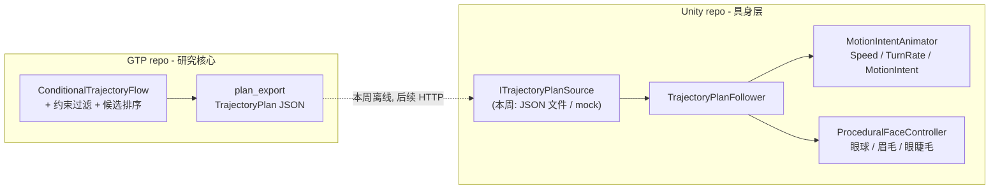

## 定位

GTP 是主角，Unity demo 是它的具身展示层。这决定了本周所有 Unity 工作的一条硬原则：

**所有新增的行为/动画接口都按 GTP 已经定稿的契约来写，本周用本地 mock 数据驱动。** 这样等 GTO 侧修好 fallback、加上 `POST /plan` 服务后，换数据源是改一个 `ITrajectoryPlanSource` 实现的事，不用重写具身层。

契约来自 [src/gtp/schema.py](D:/desktop/DQZ/generative-trajectory-planning/src/gtp/schema.py) 和 [src/gtp/integrations/plan_export.py](D:/desktop/DQZ/generative-trajectory-planning/src/gtp/integrations/plan_export.py)，需要在 C# 侧镜像的是：

- `MOTION_INTENTS = ("idle", "walk", "turn", "stop", "wave")`，索引 0-4
- `TrajectoryPlan`：`plan_id`、`horizon`、`trajectory[{t, position, yaw, velocity, angular_velocity, speed}]`、`segments[{start, end, action, prompt}]`、`score`、`fallback`
- 控制率 10 Hz，horizon 30 步 = 3 秒

## 资产层现状（已核实，决定了能做什么）

Vexa 骨架是完整双足 biped，`Base HumanPelvis / Spine1-3 / Ribcage / Neck / Head / Collarbone / Upperarm1-3 / Forearm1-3 / Palm / Digit11-54 / Thigh / Calf / Foot / Toes`，五指齐全。

- **没有任何 blendshape**：[Vefects_Vexa.prefab](D:/desktop/Unity/Unity-digital-Human/Assets/Vefects/Stylized%20Female%20Character%20-%20Vexa/Prefabs/Vefects_Vexa.prefab) 第 2581 行 `m_BlendShapeWeights: []`。也没有 jaw 骨。所以 **viseme 口型同步做不了**，不要在这上面浪费时间。
- **但有面部骨骼**：`LEyeBall`、`REyeBall`、`LEyeBrow`、`REyeBrow`、`LUpperLash`、`LLowLash`、`RUpperLash`、`RLowLash`。眨眼、扫视、眉毛情绪全部可以用骨骼旋转做，这是本周性价比最高的具身产出。
- **25 个动画片段里没有 walk/run**：只有 Idle、IdleChill、Dash、Jump、各种法术攻击。且 FBX 是 `animationType: 2`（Generic），必须转 Humanoid 才能重定向 Mixamo 的行走动画。
- 现有 [DigitalHuman.controller](D:/desktop/Unity/Unity-digital-Human/Assets/DigitalHuman/Animations/DigitalHuman.controller) 只有一个空 Idle 状态 + 3 个没被任何动画用到的 bool（`IsTalking`/`IsListening`/`IsThinking`）。

## 逐日任务

### Day 1：Humanoid 重定向 + 行走动画

1. 把 [Vefects_Vexa.fbx](D:/desktop/Unity/Unity-digital-Human/Assets/Vefects/Stylized%20Female%20Character%20-%20Vexa/Meshes/Vefects_Vexa.fbx) 的 Rig 从 Generic 改为 Humanoid，Configure 里手工补映射（骨骼名是 `Base Human*` 不是 Unity 标准名，自动映射大概率能中大部分，手指和 Toes 可能要补）。
2. 25 个 `*_Vexa.fbx` 动画文件改为 Humanoid + `Copy From Other Avatar` 指向上一步生成的 avatar。先只处理本周要用的 `Idle_Vexa.fbx`、`IdleChill_Vexa.fbx`，其余批量处理但不逐个验收。
3. 从 Mixamo 下载 Idle / Walk Forward / Walk Turn Left / Walk Turn Right / Waving 五个片段（FBX for Unity，无 skin），导入并重定向。
4. 验收：Vexa 在场景里能循环播放 walk 而不脚滑穿模。

**这一天是唯一有真实失败风险的环节**（Generic 转 Humanoid 有可能让现有 25 个片段错位）。做之前先 `git commit` 一次干净状态。如果映射失败，退路是保留 Generic 并只用 Mixamo 片段单独建一套 Humanoid 角色，把 Vexa 当纯视觉网格。

### Day 2：按 GTP intent 词表重建动画状态机

重写 `DigitalHuman.controller`：

- 参数：`Speed`（float，m/s）、`TurnRate`（float，rad/s）、`MotionIntent`（int，0-4 对齐 `MOTION_INTENTS`）、`Wave`（trigger）
- Base Layer：1D Blend Tree on `Speed`（Idle → Walk），加 turn-in-place 状态由 `TurnRate` 驱动
- Upper Body Layer（Avatar Mask，仅上半身）：wave / 手势，Override，权重由情绪强度调制

新增 `Assets/DigitalHuman/Scripts/Animation/MotionIntentAnimator.cs`，替代现有 [DigitalHumanAnimator.cs](D:/desktop/Unity/Unity-digital-Human/Assets/DigitalHuman/Scripts/Animation/DigitalHumanAnimator.cs) 的三个 bool 逻辑。旧的 [ProceduralHumanoidAnimator.cs](D:/desktop/Unity/Unity-digital-Human/Assets/DigitalHuman/Scripts/Animation/ProceduralHumanoidAnimator.cs)（正弦波摆骨头）在有真动画后就是负资产，删掉。

### Day 3：GTP 契约的 C# 镜像 + 轨迹跟随

新建 `Assets/DigitalHuman/Scripts/Planning/`：

- `TrajectoryPlan.cs` / `MotionSegment.cs`：严格镜像 `plan_export` 的 JSON 输出，字段名一字不改，用 `JsonUtility` 直接反序列化
- `ITrajectoryPlanSource.cs`：`Task<TrajectoryPlan> RequestPlanAsync(PlanRequest, CancellationToken)`
- `JsonFileTrajectoryPlanSource.cs`：读取 [results/greet_plan.json](D:/desktop/DQZ/generative-trajectory-planning/results/greet_plan.json) 这类文件，本周的驱动源
- `MockTrajectoryPlanSource.cs`：程序化生成一条绕障走过去 + 停 + 挥手的 plan，因为真实导出目前全是 `fallback: true` 的原地站立，没法用来做具身演示
- `TrajectoryPlanFollower.cs`：按 10 Hz 消费世界坐标点驱动根运动，把速度/角速度/当前 segment 的 action 喂给 `MotionIntentAnimator`，`fallback == true` 时保持 idle 不动

NavMesh 那套（[AgentMovement.cs](D:/desktop/Unity/Unity-digital-Human/Assets/DigitalHuman/Scripts/Interaction/AgentMovement.cs)）保留，[AgentInteraction](D:/desktop/Unity/Unity-digital-Human/Assets/DigitalHuman/Scripts/Interaction/AgentInteraction.cs) 的拾取还依赖它，两条路径共存并可切换。

再加 `TrajectoryDebugRenderer.cs`：画出规划路径、3 秒 horizon、segment 边界和 intent 标签。这个可视化后续扩展成"画出全部 16 条候选、被拒的标红、选中的标绿"，是整个研究故事在 30 秒视频里最有说服力的一帧。

### Day 4：程序化面部与注视

新建 `Assets/DigitalHuman/Scripts/Animation/ProceduralFaceController.cs`，纯骨骼驱动：

- **眨眼**：`*Lash` 骨骼旋转，基础频率 + 泊松抖动，说话时频率上升
- **注视**：`LEyeBall`/`REyeBall` 追踪玩家，带 saccade 抖动和 vergence；`Neck`/`Head` 二级跟随并限幅
- **注视回避**：`Thinking` 状态时视线移开（这是有文献支撑的行为，不是拍脑袋的效果，写在 README 里能撑起"computational media"的叙事）
- **眉毛情绪**：`*EyeBrow` 骨骼按 emotion 状态插值

把现有 [LookAtController.cs](D:/desktop/Unity/Unity-digital-Human/Assets/DigitalHuman/Scripts/Interaction/LookAtController.cs) 收敛进来或让它只负责身体朝向。

### Day 5：语言到具身行为（修 LLM 被绕过的 bug）+ 情绪标签

现在 [DialogueController.cs](D:/desktop/Unity/Unity-digital-Human/Assets/DigitalHuman/Scripts/Core/DialogueController.cs) 第 168-173 行，`agentCommandController.ExecuteCommand()` 在 LLM 之前拦截并直接 return，命令类输入根本不走模型。改为：

1. LLM 优先，[AgentCommandController](D:/desktop/Unity/Unity-digital-Human/Assets/DigitalHuman/Scripts/Interaction/AgentCommandController.cs) 的关键字解析降级为 LLM 失败时的兜底
2. 在 [DigitalHumanPersona.BuildSystemPrompt](D:/desktop/Unity/Unity-digital-Human/Assets/DigitalHuman/Scripts/AI/DigitalHumanPersona.cs) 里要求模型输出末尾带有界标签，形如 `[intent:walk][emotion:curious]`，intent 取值限定在 `MOTION_INTENTS` 内
3. 新增 `ResponseAnnotationParser.cs` 剥离标签、驱动 `MotionIntentAnimator` 和 `ProceduralFaceController`，标签非法时安全降级为 `idle` / `neutral`

这一步是情绪与手势的数据来源，也是让"LLM 驱动数字人"这句话字面成立的唯一改动。

**可选（时间够再做）**：`OpenAITtsVoiceService : IVoiceService` 替换 [MockVoiceService.cs](D:/desktop/Unity/Unity-digital-Human/Assets/DigitalHuman/Scripts/Voice/MockVoiceService.cs)，走 `/v1/audio/speech` 请求 `response_format: pcm`（24kHz mono PCM16），直接构造 `AudioClip`，复用现有的环境变量取 key 的模式。因为没有 blendshape 和 jaw 骨，配套的不是口型而是音频振幅驱动的头部微动 + 说话手势层。

### Day 6-7：仓库卫生与叙事包装

Unity 仓库：

- 删掉根目录 40+ 个 `.log` 和 `NewFile1.txt`（里面是一段 `unity mcp configure grok` 的报错粘贴），`.gitignore` 加 `*.log`
- 25 个 `DigitalHumanStepNBootstrap.cs` 一次性编辑器脚本（[Scripts/Editor/](D:/desktop/Unity/Unity-digital-Human/Assets/DigitalHuman/Scripts/Editor)）合并成一个 `DigitalHumanSceneBootstrap.cs`，或整体移入 `Tools~/`。这是教授点开仓库时最刺眼的"AI 流水线残渣"信号
- 加 `DigitalHuman.asmdef` + `DigitalHuman.Tests.asmdef`。`com.unity.test-framework` 已装但零测试，补 6 个纯逻辑单测：`OpenAILLMService.BuildRequestJson` / `ParseResponseJson`、`DigitalHumanPersona.BuildSystemPrompt`、`TrajectoryPlan` JSON 解析、intent 索引映射、标签解析的非法输入降级
- 重写 [README.md](D:/desktop/Unity/Unity-digital-Human/README.md)：现在是 150 行 Unity CLI 安装说明，完全没说这个项目是什么、展示了什么。改成开头一个 GIF + 架构图 + intent 契约表 + 指向 GTP 仓库的链接。顺手修掉 clone URL 指向 `QizhouD/LLM-NPC` 的问题

GTP 仓库只加一处：README 顶部加一段"Embodied demo"并链回 Unity 仓库，双向可达。

最后录 demo 视频：走近 → 对话 → 下指令 → 规划路径可视化 → 绕障行走 → 停下转身 → 挥手 → 注视与眨眼特写。

## 本周不做，但必须记下来的 GTP 待办

按你的选择本周不动 GTP 代码，但这几条是它作为"主角"必须解决的，优先级最高的一条会让任何 demo 都失效：

1. **fallback 必修**：[results/greet_plan.json](D:/desktop/DQZ/generative-trajectory-planning/results/greet_plan.json) 和 `runtime_plan.json` 的 `fallback` 都是 `true`，score 一万多（回退惩罚），30 个点全零。原因是 [constraints.py](D:/desktop/DQZ/generative-trajectory-planning/src/gtp/planning/constraints.py) 的 `negative_speed`（speed 通道 < 0）和 `implied_speed > 3.0` 两条硬约束，对一个从 N(0,1) 出发、输出层无任何参数化约束、只训了 2 epoch 的 flow 模型近乎必然全中，16 个候选被全拒。
2. 全量数据集从未生成（`data/synthetic_navigation.jsonl` 缺失，只有 `pilot_navigation.jsonl`），全量配置 `runs/digital_human_flow` 从未训练，现有 checkpoint 是 hidden=64 / 2 epoch 的 CPU smoke 产物。CPU 上跑全量配置是可行的。
3. 输出参数化：speed 通道走 softplus，或在约束过滤前加一步投影修复（projection/repair）而不是纯拒绝采样。**"约束投影 vs 拒绝采样，以 fallback rate 为指标"本身就是一个可发表的消融实验**，比单纯修 bug 有价值得多。
4. `POST /plan` 服务端（stdlib `http.server` 就够，仓库已经刻意零 HTTP 依赖），这样 Unity 侧换掉 `JsonFileTrajectoryPlanSource` 就能闭环。
5. `evaluate.py` 目前没报 fallback rate 和最小间隙，而这两个恰好是 [DIGITAL_HUMAN_ARCHITECTURE.md](D:/desktop/DQZ/generative-trajectory-planning/docs/DIGITAL_HUMAN_ARCHITECTURE.md) 里写明的验收指标。

## 风险

- Day 1 的 Generic → Humanoid 转换是唯一可能推翻后续安排的环节，先提交干净状态，失败就走"Vexa 当纯网格 + 独立 Humanoid 角色"的退路。
- 本周 Unity 演示的轨迹来自 mock 源，不是真模型输出。README 和视频描述里必须写清楚这一点，学术诚信上不能含糊。
- 没有 blendshape 和 jaw 骨，"数字人"不要对外宣称有口型同步或面部表情捕捉，只讲注视、眨眼、眉毛和全身手势。