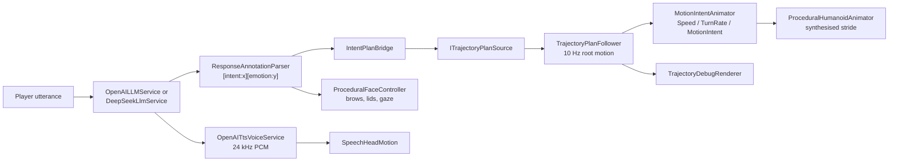

# Unity Digital Human: the embodiment layer

An NPC you talk to in natural language, whose body does what the conversation
implies. A language model answers in prose and appends two bounded tags; the tags
become a trajectory-planner goal and a facial state; the planner's output drives
the root transform at 10 Hz.

<!-- GIF goes here: shots 4-6 of docs/demo-recording.md, 800px, under 5 MB. -->
*Demo recording pending. The shot list and capture settings are in
[docs/demo-recording.md](docs/demo-recording.md).*

This repository is the **embodiment layer** for the research in
[language-conditioned generative trajectory planning](https://github.com/QizhouD/language-conditioned-generative-trajectory-planning-for-real-time-digital-humans)
(GTP). That repository is the research contribution: a conditional flow model
that generates navigation trajectories under hard constraints. This one is how it
becomes a body you can look at.

> **On honesty:** the trajectories shown in this demo come from
> `MockTrajectoryPlanSource`, a procedural generator, **not** from the trained
> model. Every current GTP export is a constraint-filter fallback (all 16
> candidates rejected). The contract, not the data, is what is real here: swapping
> in the trained planner is one `ITrajectoryPlanSource` implementation.
> See [Plan sources](#plan-sources).

## The chain, end to end



Each arrow is a seam that can be swapped. The model can be replaced without
touching the body, and the plan source can be replaced without touching either.

## The intent contract

The vocabulary is shared with the planner and is deliberately tiny. It is defined
once in Python as `MOTION_INTENTS` in `src/gtp/schema.py`, and mirrored in
`MotionIntent`. **The integer values are the wire format and must not be
reordered.**

| Index | Name | What the body does |
| --- | --- | --- |
| 0 | `idle` | Stand, breathe, blink, track the player |
| 1 | `walk` | Request a plan towards the player, route around pickup items |
| 2 | `turn` | Turn in place to face the player |
| 3 | `stop` | Abandon the active plan and hold |
| 4 | `wave` | One-shot upper-body gesture, then release to idle |

A `TrajectoryPlan` crossing the boundary is JSON with these fields, matching
`gtp.integrations.plan_export.build_trajectory_plan` exactly:

```json
{
  "plan_id": "greet-0007",
  "horizon": 3.0,
  "trajectory": [
    { "t": 0.0, "position": [0.0, 0.0], "yaw": 0.0,
      "velocity": [0.0, 0.0], "angular_velocity": 0.0, "speed": 0.0 }
  ],
  "segments": [
    { "start": 0.0, "end": 2.1, "action": "walk", "prompt": "walk over to the player" }
  ],
  "score": 0.42,
  "fallback": false
}
```

Control rate is 10 Hz and the horizon is 30 steps, so a plan covers 3 seconds and
is replanned every second while walking.

`fallback: true` means the planner rejected every candidate. The follower then
**holds idle** rather than interpolating a rejected path. Standing still is the
honest response to "no feasible plan", and it makes the failure visible instead of
hiding it.

## What the language model actually controls

Before this layer existed, `AgentCommandController` matched keywords and returned
*before* the model was ever called, so any command-shaped input bypassed it
entirely. That is fixed: the model always answers, and the keyword parser is
reduced to supplying the world action for the sentence the model already replied
to.

The model is asked to end each reply with two tags:

```text
Of course, follow me. [intent:walk][emotion:curious]
```

`ResponseAnnotationParser` extracts them, strips them before anything is
displayed or spoken, and degrades anything outside the vocabulary to
`idle` / `neutral`. Both vocabularies are enumerated into the system prompt from
the enums themselves, so the prompt and the parser cannot drift apart; a test
asserts that the prompt's own example parses.

Emotion has five values (`neutral`, `curious`, `happy`, `concerned`,
`surprised`) because eyebrows and eyelids are the entire available expressive
channel. See below.

## What this character cannot do

The mesh has **no blend shapes and no jaw bone**, so:

- **No lip sync, no visemes.** Mouth shape is baked into the texture.
- **No facial expression capture.** Expression is eyebrows and eyelids only.
- **No retargeted mocap.** The rig is Generic, and the package ships no walk
  clip, so the stride is synthesised procedurally.

Rather than fake any of that, the expressive budget went into the channels the
rig does have: blinking on a Poisson process, eye saccades, layered eye-then-head
gaze, **gaze aversion while thinking**, eyebrow emotion, and speech-loudness-driven
head motion in place of lip sync.

Gaze aversion is the one behaviour chosen for its research basis rather than its
looks: aversion rises with cognitive load, and looking away measurably improves
performance on hard questions. Modelling model latency as *looking away* rather
than as a spinner makes the wait legible as behaviour instead of as a UI artifact.

Full rationale, with the layer ordering and the citations, is in
[docs/embodiment-behaviours.md](docs/embodiment-behaviours.md). The rig
constraints and a documented Humanoid-conversion path are in
[docs/rig-and-animation.md](docs/rig-and-animation.md).

## Plan sources

`ITrajectoryPlanSource` is one method:

```csharp
Task<TrajectoryPlan> RequestPlanAsync(PlanRequest request, CancellationToken token);
```

| Implementation | Use |
| --- | --- |
| `MockTrajectoryPlanSource` | **Default.** Bezier route around obstacles with a trapezoidal speed profile. What the demo shows. |
| `JsonFileTrajectoryPlanSource` | Replays a `results/*.json` export from the GTP repo. |
| *(not yet)* `HttpTrajectoryPlanSource` | Will call `POST /plan` once the GTP service exists. |

The mock is the default for one reason: it produces a plan worth watching, and
the trained checkpoint currently does not. Its tests assert the properties a real
planner must also satisfy: monotonic timestamps at the control rate, progress
towards the goal, obstacle clearance, speed within the kinematic budget, and
segments tiling the horizon without gaps. That makes it a contract fixture, not
just a stand-in.

## Running it

Requires Unity **6000.2.15f1** (exactly; see `ProjectSettings/ProjectVersion.txt`)
and Git LFS.

```bash
git lfs install
git clone https://github.com/QizhouD/LLM-NPC.git
cd LLM-NPC
git lfs pull
```

The GitHub repository name is historical; the project is the one described here.

Open `Assets/Scenes/SampleScene.unity` and press Play. WASD to walk up to Vexa,
`E` to start talking.

**No API key is needed to evaluate the embodiment layer.** Without one the
conversation degrades to `OfflineReplyHeuristic`, a keyword table that emits the
same bounded tags the model is asked for, so the entire downstream chain (parser,
plan bridge, planner, animator, face) runs identically. Its replies are prefixed
`[offline mode]` so they cannot be mistaken for model output. `MockVoiceService`
similarly produces silent clips of the right length, which still drives the
speaking state and its blink-rate change.

### Choosing a chat backend

The chat backend is interchangeable. On the `Vexa` object, `AIConversationManager`
has a **Provider** dropdown:

| Provider | Component | Env var | API |
| --- | --- | --- | --- |
| `OpenAI` | `OpenAILLMService` | `OPENAI_API_KEY` | Responses API |
| `DeepSeek` | `DeepSeekLlmService` | `DEEPSEEK_API_KEY` | Chat Completions, `deepseek-chat` |
| `Offline` | none | none | `OfflineReplyHeuristic` |

`OpenAI` is the default. Both backends are already wired into their slots, so
switching is just the dropdown; nothing downstream of the parser knows or cares
which one answered. If the selected provider's key is missing, that turn falls
through to the same `[offline mode]` heuristic rather than failing.

Keys are read from the environment at call time and never stored in the project:

```powershell
$env:OPENAI_API_KEY = 'sk-...'
$env:DEEPSEEK_API_KEY = 'sk-...'
```

Speech is OpenAI-only, because DeepSeek publishes no equivalent of
`/v1/audio/speech`. For spoken replies, point `VoiceController`'s service field at
`OpenAITtsVoiceService` instead of `MockVoiceService`; this is independent of the
chat provider, so DeepSeek chat with OpenAI speech is a valid combination.

## Layout

| Path | Contents |
| --- | --- |
| `Assets/DigitalHuman/Scripts/AI/` | LLM transport, persona, annotation parsing |
| `Assets/DigitalHuman/Scripts/Animation/` | Intent vocabulary, animator ownership, procedural body and face |
| `Assets/DigitalHuman/Scripts/Planning/` | C# mirror of the GTP contract, plan sources, follower, debug overlay |
| `Assets/DigitalHuman/Scripts/Interaction/` | NavMesh movement, pickup, look-at |
| `Assets/DigitalHuman/Scripts/Voice/` | TTS, playback, speech-driven head motion |
| `Assets/DigitalHuman/Scripts/Editor/` | Three tools: rig setup, animator controller builder, scene wiring |
| `Assets/DigitalHuman/Tests/` | 127 EditMode tests |
| `docs/` | Why the behaviours are what they are; rig constraints |
| `Tools/LegacyEditorBootstrap/` | One-off scripts that built the scene, kept as a record, outside `Assets/` so Unity ignores them |

Every scene-affecting editor action is a callable method rather than a
hand-clicked step, so the setup is reproducible:
**Digital Human > Scene > Wire Animation Stack**,
**Digital Human > Animation > Rebuild Animator Controller**,
**Digital Human > Rig**.

## Tests

127 EditMode tests, no play mode or scene fixtures required. They cover the
seams where a silent failure would be expensive: both backends' request and
response shapes, provider selection and its keyless fallback, the system prompt,
`TrajectoryPlan` parsing and interpolation including yaw wrap-around, intent
index mapping, PCM decoding, the additive animation layer's no-accumulation
guarantee, and the annotation parser's degradation on hostile input.

```bash
unity command run_tests
```

## Development notes

Committed: `Assets/` with every `.meta`, `ProjectSettings/`,
`Packages/manifest.json` and `packages-lock.json`. Regenerated locally and
ignored: `Library/`, `Temp/`, `Logs/`, `UserSettings/`, `*.csproj`, `*.sln`,
`*.log`.

Asset serialization is Force Text and meta files are visible, so scenes and
prefabs diff. Rename and move assets **inside Unity** so meta GUIDs follow.

Never commit an API key. `*Secrets*.asset`, `.env` and `*.key` are ignored.
